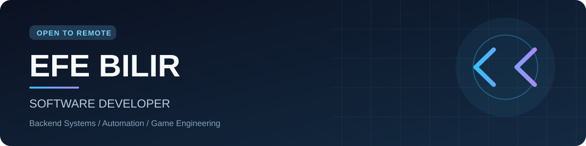

 

### I don't just write code. I build systems.

**Efe Bilir** · Independent Software Developer · Istanbul, Türkiye  
**Building game systems, desktop tools, automation & interactive web experiences.**

**Portfolio preview:** [efedev.pages.dev](https://efedev.pages.dev/) · **Custom domain:** `efedev.com.tr` (connection pending)

---

## About me

I'm **Efe**, a developer with a background in **Information Technologies / Software Development**. I enjoy turning ideas into working tools—from multiplayer game mechanics and server-side software to Windows desktop automation and motion-driven websites.

I care about **maintainability, practical performance, debugging, and verification**. I build independent projects and continuously improve them through testing and iteration.

- **Currently exploring:** desktop AI assistants, developer tooling, interactive UI and engineering workflows
- **Open to:** remote software development, technical collaboration, game systems and automation work
- **Languages:** Turkish (native) · English (B2)

## Selected work

> Projects listed here reflect my independent development work. Some source code, assets, and demonstrations are private or not published yet. A project description is **not** a link to an existing public repository.

<table>
<tr>
<td width="50%" valign="top">

### 🖥️ JARVIS — Windows Desktop Assistant
**Python · Tkinter · Windows automation**

A modular personal desktop-assistant project exploring application interaction, tool orchestration, local integrations, and a custom Windows HUD interface.

**Current focus:** reliability · safe automation · extensible tools

</td>
<td width="50%" valign="top">

### 🏎️ VANTA — Cinematic Web Experience
**React · TypeScript · GSAP · ScrollTrigger · Lenis**

An original interactive website for a **fictional** hypercar brand. Built around scroll-driven storytelling, custom SVG visuals, responsive motion and accessible reduced-motion behavior.

**Current focus:** motion design · frontend engineering · visual polish

</td>
</tr>
<tr>
<td width="50%" valign="top">

### 🧩 KTX Suite
**Java · Minecraft Paper · modular plugins**

A collection of game-server systems including anticheat, spawners, progression, administration and gameplay features.

**Current focus:** maintainability · game mechanics · testing

</td>
<td width="50%" valign="top">

### 🌌 Vex Craft
**Minecraft · SkyBlock · server-side systems**

A custom SkyBlock/server development project involving progression loops, game economies and gameplay infrastructure.

**Current focus:** gameplay systems · balancing · integrations

</td>
</tr>
<tr>
<td width="50%" valign="top">

### 🤖 Discord Ecosystems
**JavaScript · Discord.js · automation**

Community support and moderation workflows, ticket tools and event-based integrations.

**Current focus:** automation · reliable workflows · user experience

</td>
<td width="50%" valign="top">

### 🧪 Desktop & Workflow Experiments
**Python · tooling · QA**

Smaller experiments including AI Screen Assistant and Maps Evaluation Intelligence, focused on desktop interfaces, structured workflows and validation.

**Current focus:** practical utilities · testing · iteration

</td>
</tr>
</table>

## Engineering toolkit

**Languages & web**

**Tools & workflow**

Technologies used or explored across projects; this is not an equal-proficiency ranking.

## How I build

<table>
<tr>
<td width="33%" valign="top"><strong>01 / Understand</strong>  Clarify the real problem, constraints, and existing architecture before making changes.</td>
<td width="33%" valign="top"><strong>02 / Implement</strong>  Choose a focused, maintainable approach. Keep dependencies and complexity intentional.</td>
<td width="33%" valign="top"><strong>03 / Verify</strong>  Run real builds and tests, inspect failures, and document what is—and is not—confirmed.</td>
</tr>
</table>

## Currently building

- **EFEDEV portfolio** — bilingual cinematic personal website, deployed on Cloudflare Pages; connecting `efedev.com.tr`
- **JARVIS** — refining the desktop-assistant architecture and testing workflows
- **VANTA V2** — polishing SVG automotive visuals, responsive layouts and scroll interactions
- **Public case studies** — preparing accurate technical write-ups and publishable examples

## Connect

I'm interested in meaningful remote software opportunities and collaborations where practical engineering matters.

- **Email:** [biliribrahimefe@gmail.com](mailto:biliribrahimefe@gmail.com)
- **Live preview:** [efedev.pages.dev](https://efedev.pages.dev/)  
- **Custom domain:** `efedev.com.tr` *(DNS / Pages connection pending)*
- **GitHub:** [@biliribrahimefe-crypto](https://github.com/biliribrahimefe-crypto)
- **Based in:** Istanbul, Türkiye

---

**EFEDEV · Efe Bilir**  
Build with purpose. Test with care. Improve continuously.

